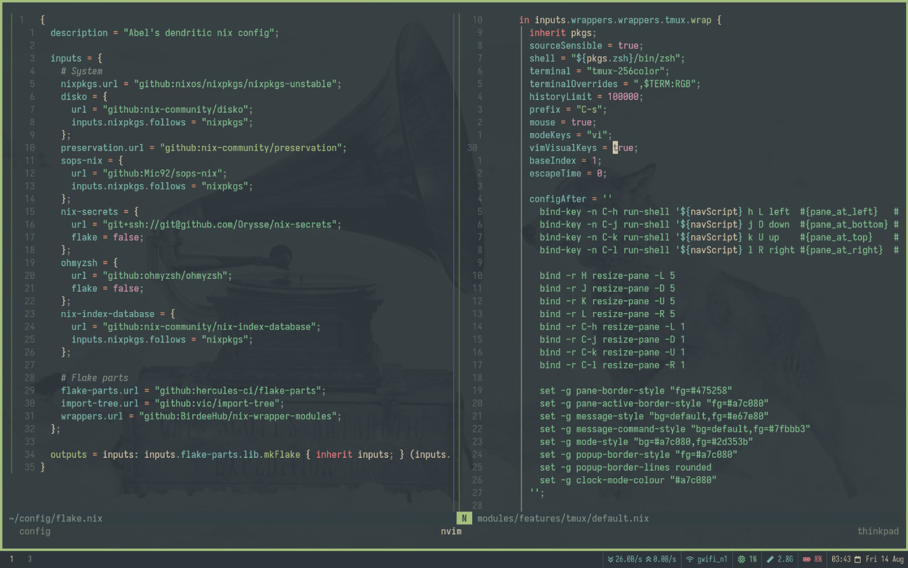

# thinkpad — dendritic NixOS config

NixOS configuration for my `thinkpad`, built with the dendritic pattern (flake-parts + [import-tree](https://github.com/vic/import-tree)) instead of a hand-maintained module list.

## Screenshot



## Structure

```
modules/
├─ parts.nix     flake-parts systems
├─ features/     one app per folder — perSystem package + nixosModule
├─ system/       core system modules (boot, users, network, impermanence)
├─ flavors/      optional per-host profiles (dev, infra, security, secrets)
└─ hosts/        nixosConfigurations
```

## Key facts

- No home-manager — programs are configured via [nix-wrapper-modules](https://github.com/BirdeeHub/nix-wrapper-modules) instead.
- `/` is tmpfs; only `/nix` and `/persistent` survive a reboot ([preservation](https://github.com/nix-community/preservation)).
- Disk layout is fully declarative via [disko](https://github.com/nix-community/disko) (GPT + LUKS + btrfs).
- Secrets are decrypted via [sops-nix](https://github.com/Mic92/sops-nix), keyed to a YubiKey or the host's SSH key, pulled from a separate encrypted repo (`nix-secrets`).
- Desktop: sway, waybar, wob, kanshi, fuzzel, kitty, tmux, zsh, nvim — Everforest Dark Medium throughout.
- Every feature is independently runnable: `nix run .#kitty`, `nix build .#zsh`, etc.

## Docs

- [New host bootstrap](./docs/new-host-bootstrap.md) — disk setup, password hashes, registering a host as a secrets recipient.
- [Secure boot / measured boot host enrollment](./docs/secure-boot-enrollment.md) — continues from there: lanzaboote + Secure Boot + TPM2 LUKS unlock.

## Commands

```bash
nix flake check
nix build .#nixosConfigurations.thinkpad.config.system.build.toplevel
nh os switch
```
